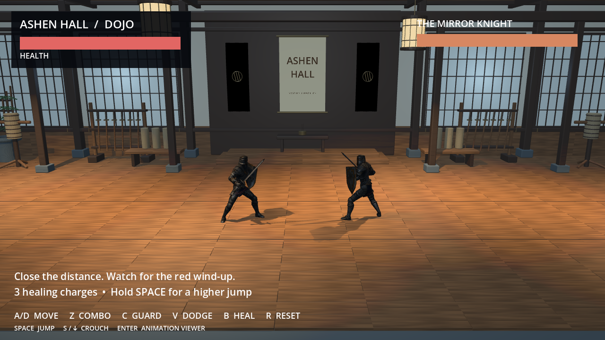
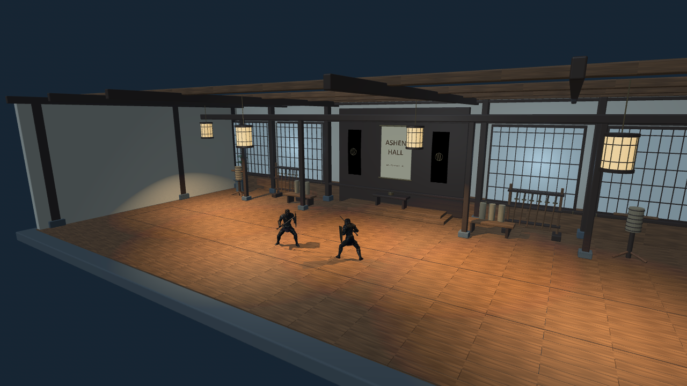

# Ashen Hall

Godot 4.6 2.5D knight training dojo: fully 3D models, with gameplay constrained to a side-scrolling plane. Open `project.godot` in Godot 4.6 and press **F5**, or run `godot --path .`.

## Controls

| Control | Action |
| --- | --- |
| A/D or left/right arrows | Run |
| Z, repeated presses | Three-stage One Hand Sword Combo: tap once, twice, or three times |
| C, held | Raise shield and guard |
| V + direction | Direction-locked forward roll |
| V without direction | Standing backward dodge |
| Space | Jump; tap clears the opponent, hold for a higher jump |
| S/down arrow, held | Crouch; release to stand |
| B | Heal 100 HP; three charges |
| Enter | Animation viewer |
| R | Restart duel |

Both knights have **250 HP**. Heavy attacks and stamina have been removed. Guard reduces frontal damage; back attacks bypass it. The opponent's red ring warns of an attack. Living knights have solid body colliders, maintaining about 0.84 metres of centre separation on the ground. Walking and attack steps stop at body contact. Forward rolls temporarily pass through the opponent, then restore solid collision with safe separation if the roll ends at their body. Backsteps remain solid. Confirmed hits apply a brief recoil rather than a continuous shove. You can still jump over the opponent. Dead bodies stop blocking movement. After victory, keep exploring; after defeat, your knight recovers after its death animation. R starts a fresh duel.

## Movement and animation timing

Running is 5.5 m/s. The camera uses perspective projection with a 42-degree field of view and follows the player. Foreground objects appear larger and move faster across the view than distant room details. Grounded direction changes are immediate, with a quick smooth facing blend and no turn-animation action lock. The running animation continues rather than restarting for every reversal; crouched direction changes keep the crouch pose. Uploaded turn clips remain available only in the viewer. The forward roll uses **Sprinting Forward Roll.fbx** over 0.68 seconds, with quicker playback during the opening dive and a smooth transition into its rolling phase. It carries running momentum in/out and covers about 3.9 metres with direction held, down from about five metres. A new dodge press is buffered for 0.4 seconds, so pressing V before recovery ends can chain directly into another roll. Roll direction is locked per roll. During the final roll recovery, releasing direction blends into a generated idle recovery before the source clip's running tail; keeping direction held blends into running. The destination animation starts during recovery instead of waiting for an extra idle/run frame afterward. The backward dodge is faster (0.88 seconds) while keeping the same source-synchronized travel curve and roughly two-metre distance.

Z uses **One Hand Sword Combo.fbx** for the standing three-stage combo. Only one upcoming swing can be buffered, during the last 0.35 seconds of the current swing; repeated presses replace that same buffer instead of adding more attacks. A third swing requires a fresh follow-up press during swing two. Holding Z does not automatically continue. Pressing during recovery can still continue into the next allowed stage.

The stages play at 1.8× source speed. Their boundaries preserve the original clip's poses and movement between swings. The character body follows the source's recorded forward travel during each swing and its authored final recovery, so the knight takes the actual steps rather than sliding in place. Travel is mirrored when facing left and remains subject to arena and opponent collision. If you stop after swing one or two, a short eased recovery returns the knight to its normal idle stance. Swing three uses the source clip's own final recovery. A press during an early stage's recovery can still continue to the next swing. Damage fires once per chosen swing, and being hit cancels the queued stages. The mirror knight now uses the player's attack and roll implementations; see its pattern below. Melee reach is 1.65 metres; its approach distance is 1.25 metres, keeping it in range. Confirmed hits apply a short impulse that decelerates at 18 m/s², rather than moving the defender throughout the whole impact animation. A normal hit recoils about 0.28 m, a guarded hit about 0.04 m, with less recoil while crouched. Solid-body contact and missed attacks apply no impulse, and close-range combo hits remain within reach.

Press Z late in a roll **or backstep**, or within 0.22 seconds after either finishes, to use **Sword And Shield Attack (1).fbx** as the dodge-attack opener. A direction held with that press selects the attack facing, including reversing the roll heading; without direction it retains facing. This opener bypasses normal movement turns and can immediately interrupt an incipient post-roll turn within the dodge-attack window. An early dodge press is ignored, and waiting past the window restores the normal opener. This attack uses its recorded lunge and registers one hit. Press Z again to chain into the newly supplied **Sword And Shield Slash (1).fbx**; compatible source poses and a short blend connect the two without an idle clip. This dodge-attack branch now ends after its two attacks: the opener and uploaded slash follow-up. Mashing cannot add a third swing. The opener permits one forgiving follow-up buffer, but extra taps do not stack. Standing combos retain three stages with the single near-end buffer described above.

The full uncut source clip is available in the Enter-key animation viewer. Internally generated stage and recovery clips are hidden from that filename list.

Jumping keeps the uploaded Moving Jump and Sword And Shield Jump poses. Physical takeoff follows anticipation. A stationary takeoff stays planted even if direction is entered during the anticipation; gradual air steering starts only after takeoff. The authored vertical flight offset is subtracted from the model so the animation no longer adds a second arc on top of physics. Gravity slows upward velocity naturally toward the apex. Tapped and held jumps reach approximately 1.97 and 2.37 metres at the character body, retaining clearance over the 1.8-metre opponent without the earlier excessive height.

Facing stays locked during flight. Air input accelerates gradually: opposite input first brakes forward momentum, then permits a small reverse drift capped at 28% of running speed. A stationary takeoff has limited air steering in either direction. On contact, same-direction input resumes running, opposite input switches into running with the same quick facing blend, and no input selects a short landing-to-idle recovery rather than the moving clip's running tail. Jump and landing blends maintain foot contact above the arena floor instead of dipping through it. The stationary clip stops before its wide landing stance until actual contact, so the knight stays tucked in the air.

Crouching takes 0.15 seconds, standing up 0.18 seconds. Hold S/down and C together: Crouch Block Begin plays once, then a corrected crouched guard idle loops while crouch and guard remain held. The supplied Shield Crouch Idle contains the lowered-arm pose, so the game retains its body idle motion while holding the shield arm at the raised endpoint of Crouch Block Begin. Releasing C plays Crouch Block Begin backward into the default crouch; pressing it again while lowering reverses back into raising. Original source clips remain unchanged for preview.

## Animation assignments

| Situation | Supplied filename |
| --- | --- |
| Front hit | Impact.fbx |
| Frontal hit while guarding | Shield Impact.fbx |
| Rear hit | Back Impact.fbx |
| Crouched hit | Crouch Impact.fbx |
| Crouched frontal guard hit | Crouch Shield Impact.fbx |
| Forward roll | Sprinting Forward Roll.fbx |
| No-input dodge | Standing Dodge Backward.fbx |
| Moving / stationary jump | Moving Jump.fbx / Sword And Shield Jump.fbx |
| Player three-swing combo | One Hand Sword Combo.fbx (three stages, with separate recoveries) |
| Roll/backstep attack opener | Sword And Shield Attack (1).fbx |
| Dodge-attack follow-up | Sword And Shield Slash (1).fbx |
| Crouch / stand | Crouch.fbx / Crouch To Standing.fbx |
| Raise shield standing / crouched | Shield Block Begin.fbx / Crouch Block Begin.fbx |
| Crouched shield idle | Shield Crouch Idle.fbx |

## Mirror knight and dojo

The enemy shares the player's model, 250 HP, speed, attack clips, root-driven footwork, roll-through behavior, impact reactions, and knockback. It does not jump or guard. Its fixed repeating sequence is:

1. Normal swing 1.
2. Normal swing 2.
3. Roll toward the player.
4. Roll-attack opener.
5. Normal swing 1.
6. Roll toward the player.
7. Roll-attack opener.
8. Roll-attack follow-up, then recover and briefly rest before repeating.

It commits to facing during each swing and roll, retargeting only at action boundaries. The pattern continues without returning to an idle stance between its attacks. If staggered, it resumes the next remaining action rather than restarting at swing one. A brief red-ring cue announces the start of each sequence.

The room is a true 3D model in `assets/dojo/dojo.glb`, with staggered beveled floorboards, cedar color/normal/roughness textures, recessed shoji windows, timber columns and overhead beams, a raised alcove, cloth banners, detailed bokken racks, straw training dummies, benches, and hanging lanterns. The back wall sits eight metres behind the combat plane. A perspective camera makes that depth visible through size falloff and parallax.

`dojo.gd` places four warm, shadow-casting lights under the lanterns, with subtle animated sway and intensity. Cool rear lighting and a frontal fill illuminate the room and knights. Character shadows respond in real time; no lightmaps are baked. Compatibility rendering remains enabled, with 4× MSAA and anisotropic filtering.

Actual Godot gameplay render:

Angled inspection view of the same room geometry (the gameplay camera stays side-on):

The modeled room can be rebuilt with Blender 4 using `blender -b --python tools/build_dojo.py`. Blender is only needed to rebuild the room asset; playing requires Godot alone.

## Animation viewer

Press Enter to pause combat and hide the opponent. Click a filename in the scrollable list to perform it on your knight. Search filters names. Replay, Stop, Loop, speed, Turn, and Copy name help inspect clips and share choices. Enter returns to the duel without consuming health or healing charges.

There are **74 source clips**: 51 from the original Pro Sword and Shield Pack, 14 organized individual uploads, four later roll/shield uploads, One Hand Sword Combo, the dodge-attack opener, the follow-up/turn uploads, and the replacement turn (3). Original filenames are preserved in the viewer. Run Attack and the superseded roll remain available for preview. The earlier oversized Pack 2 archive was not imported in full; separately supplied files are included.

## Implementation and validation

`arena.gd` creates the camera, HUD and fighters; `dojo.gd` loads the modeled dojo and creates its lighting. `fighter.gd` handles movement, combat and animation timing. `animation_viewer.gd` provides previews. `assets/knight.glb` combines the supplied knight, textures and animation clips using their shared Mixamo skeleton. Horizontal root travel is removed from the model at runtime; recorded attack and backstep travel is applied to the character body instead. No plugins or external services are needed. Asset rights remain with their creators; the uploads did not include license documents.

Focused Godot 4.6.3 checks passed for the enemy's exact eight-action sequence over repeated cycles, shared player clips/speed/roll-through behavior, no AI jumping or guarding, facing locks through swings with retargeting between actions, stagger continuation, and animated shadow lamps. A real OpenGL software render was captured and visually inspected for room materials, illumination and character shadows. Player regression checks also passed for roll-through/restored collision, safe roll endings, capped dodge/standing attack buffers, the timed standing three-hit combo, and quick grounded/crouched direction changes. Perspective checks confirmed real projected size falloff (about 1.9× between the sampled near and far positions), depth-dependent camera parallax, textured room geometry, and correct camera restoration after animation previews.

For a cloud shell with a read-only home, set `XDG_DATA_HOME`, `XDG_CONFIG_HOME`, and `XDG_CACHE_HOME` to writable directories before launching Godot.
